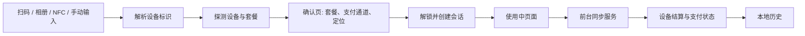

# 架构说明

本文描述项目的技术栈、模块划分、数据流与安全边界，面向希望参与开发或审阅实现的读者。

公开文档只做架构级说明，不包含接口地址、请求头、签名算法或官方客户端反编译内容。

## 技术栈

| 领域 | 选型 |
| --- | --- |
| 语言 | Kotlin 2.4.20 |
| 构建 | AGP 9.2.1、Gradle Wrapper、JDK 21 |
| UI | Jetpack Compose（BOM 2026.09.00）、Miuix 0.9.4 |
| 网络 | OkHttp 4.12.0、Retrofit 2.11.0、kotlinx.serialization 1.9.0 |
| 异步 | Kotlin Coroutines 1.10.2 |
| 本地存储 | DataStore Preferences 1.3.0、SQLite |
| 扫码 | CameraX 1.6.2、ZXing 3.5.4 |
| 平台能力 | NFC、LocationManager、前台服务、Android Keystore |

## 模块划分

项目只有一个 `:app` 模块，按职责分包：

| 包 | 职责 |
| --- | --- |
| `AppGraph` | 手动依赖注入，创建网络、存储、仓库与控制器 |
| `AppController` | 应用级状态：免责声明、登录态、消息 |
| `auth` | 短信登录、token 保存与退出 |
| `scan` | 相机预览、二维码解码、相册识别、扫描状态机 |
| `device` | 二维码/标签解析、设备探测、支付通道选择 |
| `confirm` | 确认页状态、套餐选择、定位校验、解锁流程 |
| `water` | 接水会话、阶段状态、结算决策与持久化 |
| `service` | 前台同步服务与通知渠道 |
| `history` | SQLite 历史记录、详情、删除与 CSV 导出 |
| `storage` | DataStore 配置、token 加密、免责声明与设置 |
| `net` | Retrofit 接口、请求签名拦截器、错误映射、调试日志 |
| `nfc` | NDEF 解析、标签绑定与本地映射 |
| `location` | 定位权限与当前位置读取 |
| `ui` | 根导航、主题、通用组件与格式化 |
| `debug` | 隐藏诊断页与 Debug 专属工具 |

## 数据流

关键点：

1. 扫描结果先解析为设备标识，再向官方服务探测设备详情。
2. 确认页同时准备套餐、支付通道和定位参数，完成一次解锁。
3. 解锁成功后写入本地会话，并启动 `WaterSyncService`。
4. 前台服务轮询设备状态，触发结束、结算和支付查询。
5. 会话阶段与最终结果写入 SQLite，供历史页展示和导出。
6. 应用重启时，如果存在进行中的会话，会恢复前台服务。

## 状态管理

- 页面状态以 `StateFlow` 和 Compose `State` 为主，控制器不直接持有 Activity。
- `AppGraph` 在 `Application` 中创建，作为轻量手动 DI 容器。
- `WaterSessionManager` 维护当前会话，并负责启动/结束前台服务。
- 会话阶段、支付结果和错误信息集中保存在 `WaterSession`，避免多个页面各自推断。
- 支付查询有超时上限；超时后进入“支付状态未知”，不会无限轮询或自动重试扣款。

## 本地存储

| 数据 | 位置 | 说明 |
| --- | --- | --- |
| 登录 token | DataStore + Android Keystore | AES-GCM 加密后保存，密钥不出 Keystore |
| 主题、动态取色、悬浮底栏、演练模式、一键解锁 | DataStore Preferences | 本机设置 |
| 当前接水会话 | DataStore Preferences | JSON 序列化，供前台服务恢复 |
| NFC 标签映射 | DataStore Preferences | 标签 ID → SN、设备名、商品 ID |
| 接水历史 | SQLite `pangguai_history.db` | 订单号、金额、阶段、错误与时间 |
| 调试请求日志 | 内存 | 仅 Debug，最多 100 条，退出进程即丢失 |

`allowBackup=false`，系统备份不会带走 token、历史或映射。卸载应用会删除本地数据。

## 网络与安全边界

- 网络层统一通过 OkHttp 拦截器附加登录态与设备信息，并对需要风控的请求计算签名。
- 构建所需的 API 凭据由 `secrets.properties` 或 CI Secret 注入 `BuildConfig`，不进入源码仓库。
- token 使用 Android Keystore 中的 AES-GCM 密钥加密；应用不保存明文 token。
- 设备标识使用本机 Android ID 的哈希，不读取 OAID。
- 应用不集成广告、统计或推送 SDK；网络请求只用于官方服务。
- Debug 构建才记录请求；日志会对常见敏感字段打码，但分享前仍需人工检查。
- 定位只在确认与下单流程中读取，用于构造风控参数；应用不保存位置历史。

## 非目标

以下内容不在当前范围内：

- BLE 设备解锁。
- 绕过定位、实名或风控校验。
- 自动补缴、自动重试支付或代扣。
- 多账号、社交、会员、广告与推送运营。
- 公开官方接口、签名算法或反编译材料。

## 相关文档

- [构建指南](build.md)
- [调试指南](debug.md)
- [测试与验收](testing.md)
- [隐私说明](privacy.md)
