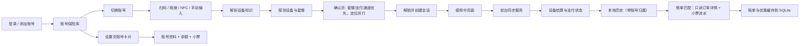

# 架构说明

本文描述项目的技术栈、模块划分、数据流与安全边界，面向希望参与开发或审阅实现的读者。

公开文档只做架构级说明，不包含接口地址、请求头、签名算法或官方客户端反编译内容。

## 技术栈

| 领域 | 选型 |
| --- | --- |
| 语言 | Kotlin 2.4.20 |
| 构建 | AGP 9.2.1、Gradle Wrapper、JDK 21 |
| UI | Jetpack Compose（BOM 2026.09.00）、Miuix 0.9.4 |
| 网络 | OkHttp 4.12.0、Retrofit 2.11.0、kotlinx.serialization 1.9.0 |
| 异步 | Kotlin Coroutines 1.10.2 |
| 本地存储 | DataStore Preferences 1.3.0、SQLite |
| 扫码 | CameraX 1.6.2、ZXing 3.5.4 |
| 图片 | Coil 3.6.3（头像加载） |
| 平台能力 | NFC、LocationManager、前台服务、Android Keystore |

## 模块划分

项目只有一个 `:app` 模块，按职责分包：

| 包 | 职责 |
| --- | --- |
| `AppGraph` | 手动依赖注入，创建网络、存储、仓库与控制器 |
| `AppController` | 应用级状态：免责声明、登录态、多账号切换、消息 |
| `account` | 多账号加密存储、登录/切换/删除、资料与资产仓库、资产快照 |
| `auth` | 登录/添加账号/重新登录界面 |
| `scan` | 相机预览、二维码解码、相册识别、扫描状态机、套餐预取 |
| `device` | 二维码/标签解析、设备探测、套餐缓存、支付通道选择 |
| `confirm` | 确认页状态、套餐缓存优先加载、定位状态、解锁流程 |
| `water` | 接水会话、阶段状态、结算决策与持久化 |
| `service` | 前台同步服务与通知渠道 |
| `history` | SQLite 历史、账单匹配与缓存、搜索/筛选纯策略、按账号隔离、详情、删除与 CSV 导出 |
| `points` | 积分页、签到/任务仓库、任务分类器、自动运行状态机与按账号运行记录 |
| `storage` | DataStore 配置、设置、免责声明、账号数据与套餐缓存 |
| `net` | Retrofit 接口、请求签名、会话失效识别、错误映射、调试日志 |
| `nfc` | NDEF 解析、标签绑定与本地映射 |
| `location` | 定位权限、内存缓存、并发读取与扫码页预热 |
| `settings` | 设置页、账号资产卡片、账号切换与小票明细页面 |
| `ui` | 根导航、主题、通用组件与格式化 |
| `debug` | 隐藏诊断页与 Debug 专属工具 |

## 数据流

关键点：

1. 扫描结果先解析为设备标识，再向官方服务探测设备详情。
2. 设备解析成功后后台预取套餐与支付通道；确认页优先展示本机缓存并在后台刷新，套餐与定位并行获取，套餐就绪即可浏览，定位就绪后才能解锁。
3. 套餐与支付方式按“设备 + 当前账号 `localId`”缓存 7 天，最多 50 条；命中先展示旧数据并后台刷新，刷新结果不改变当前确认页，避免价格与选中项跳变；解锁报错时清空该设备缓存。
4. 解锁成功后写入本地会话，并启动 `WaterSyncService`；会话记录创建时的账号 `localId`。
5. 前台服务轮询设备状态，触发结束、结算和支付查询。
6. 会话阶段与最终结果写入 SQLite，按账号隔离，供历史页展示和导出。
7. 历史页在读取本地记录后，对最近 90 天的记录按结算订单号读取只读账单；账单匹配到的优惠、实付和通用小票信息随记录缓存。更早的记录在打开详情或下拉刷新时按需请求。
8. 账单实付采用官方“实付款”口径；小票抵扣作为优惠明细展示，不重复从实付扣减。小票流水按订单号补充店铺、点数与本金/赠送；流水缺失时以账单抵扣为准并标注。
9. 账单同步有并发与批量上限；失败保留旧账单，未匹配不会用本地用量冒充金额。应用重启时，如果存在进行中的会话，会恢复前台服务。
10. 设置页的账号卡片独立加载资料与资产；失败时保留上次快照。

## 状态管理

- 页面状态以 `StateFlow` 和 Compose `State` 为主，控制器不直接持有 Activity。
- `AppGraph` 在 `Application` 中创建，作为轻量手动 DI 容器。
- `AppController` 维护应用级登录态与登录目标（首次登录、添加账号、失效重登）。
- `AssetController` 监听当前账号 `localId`，加载资料/余额/小票并维护资产快照；按 `localId` 去重，避免资料刷新触发循环请求。
- `HistoryController` 管理当前账号的历史读取、90 天账单批量同步、单条按需同步、缓存与重试状态，以及不持久化的筛选条件；它不创建、取消或支付订单。
- `HistoryFilter` 是不依赖 Android 的纯筛选策略：时间窗口、设备/状态/小票/金额条件和搜索都在这一层组合。`HistoryUiState.records` 始终保存完整记录，`HistoryScreen` 派生可见列表；账单同步、重试、删除与 CSV 仍使用完整列表。
- `WaterSessionManager` 维护当前会话，并负责启动/结束前台服务。
- 会话阶段、支付结果和错误信息集中保存在 `WaterSession`，避免多个页面各自推断。
- 支付查询有超时上限；超时后进入“支付状态未知”，不会无限轮询或自动重试扣款。

## 多账号与资产

### 账号保险库

- `AccountStore` 在现有 DataStore 中保存一个 JSON 账号列表和当前 `active_account_id`。
- 每个账号包含本地 `localId`、服务端 `serverId`、昵称/别名、头像 URL、脱敏手机号、加密手机号、加密 token、失效标记与最近使用时间。
- token 与完整手机号使用 AndroidKeyStore 的 AES-GCM 密钥分别加密；`localId` 是历史与资产快照的主键。
- 旧版本的单 token 会在首次启动时原子迁移为一条待同步账号；同步资料后补全昵称、头像与手机号。
- 添加账号时按手机号/服务端用户 ID 合并，避免同一账号重复保存；合并时迁移历史记录。
- 会话失效只标记账号并清空内存 token，不自动删除 token 密文；用户可重新登录或删除账号。
- 删除账号会同时删除该账号的资产快照与接水历史。

### 资产加载

- 资料与余额并行加载；余额点数大于 0 时再分页拉取按店铺的小票列表。
- 通用小票按 `localId` 保存最近一次成功快照；刷新失败时继续显示旧快照。
- 小票明细页按店铺展示总额/本金/赠送；点击店铺进入流水页并分页加载，`type==100` 显示为正，其他显示为负。
- 头像使用 Coil 3 加载，使用独立的普通 OkHttp 客户端，不携带登录 token 或签名头。

### 账号切换限制

- 接水会话处于进行中（使用中/结束中/结算中）时，拒绝切换、删除或退出账号。
- 切换账号会重置扫码状态；正在进行的网络刷新按代次/账号校验，旧结果不会写入新账号。
- 会话失效回调会比对“请求实际使用的 token”与当前 token，避免旧请求误伤刚切换的账号。

## 本地存储

| 数据 | 位置 | 说明 |
| --- | --- | --- |
| 账号 token（可多个） | DataStore + Android Keystore | 每个账号单独 AES-GCM 加密，密钥不出 Keystore |
| 账号资料 | DataStore | `localId`、服务端 ID、昵称/别名、头像 URL、脱敏手机号、加密完整手机号、失效标记 |
| 当前账号 | DataStore | `active_account_id`，决定请求使用的 token 与历史归属 |
| 资产快照 | DataStore | 每个账号一份资料/余额/小票汇总，刷新失败时兜底 |
| 主题、动态取色、悬浮底栏、演练模式、一键解锁、跳过设备信息、资产隐藏 | DataStore Preferences | 本机设置 |
| 当前接水会话 | DataStore Preferences | JSON 序列化，带创建时的账号 `localId`，供前台服务恢复 |
| 套餐与支付方式缓存 | DataStore Preferences（独立 `plan_cache` 文件） | 按设备与账号 `localId` 缓存；最长 7 天、最多 50 条，超出淘汰最旧；命中先展示、后台刷新 |
| NFC 标签映射 | DataStore Preferences | 标签 ID → SN、设备名、商品 ID |
| 接水历史与账单缓存 | SQLite `pangguai_history.db` | 订单号、金额、阶段、错误、时间、`account_id`，以及账单原价/优惠/实付、店铺/设备、小票抵扣与同步时间；账单 JSON 与记录同生命周期 |
| 调试请求日志 | 内存 | 仅 Debug，最多 100 条，退出进程即丢失；响应中的 token/手机号/姓名/证件号/头像地址会脱敏 |

`allowBackup=false`，系统备份不会带走 token、历史或映射。卸载应用会删除本地数据。账号合并时历史记录会迁移到合并后的 `localId`；删除账号会删除该账号的历史与资产快照。

## 网络与安全边界

- 网络层统一通过 OkHttp 拦截器附加登录态与设备信息，并对需要风控的请求计算签名。
- 构建所需的 API 凭据由 `secrets.properties` 或 CI Secret 注入 `BuildConfig`，不进入源码仓库。
- token 与完整手机号使用 Android Keystore 中的 AES-GCM 密钥加密；账号列表只保存密文与脱敏手机号。
- 设备标识使用本机 Android ID 的哈希，不读取 OAID。
- 会话失效由统一响应拦截器识别：仅当请求实际使用的 token 等于当前 token 时，才把对应账号标记为失效并回到登录流程；登录/验证码请求被排除。
- 头像加载使用独立的普通 OkHttp 客户端，不附加登录态或签名头；图片请求只会访问资料中返回的头像地址。
- 应用不集成广告、统计或推送 SDK；业务请求只用于官方服务，头像请求用于资料中的图片地址。
- 账单匹配只读取订单与通用小票流水，不创建、取消或支付订单；账单缓存随历史记录按账号隔离，删除记录、清空历史或删除账号时一并删除。
- Debug 构建才记录请求；请求与响应中的常见敏感字段都会打码，但分享前仍需人工检查。
- 定位在扫码页已授权时静默预热，确认与下单流程读取风控参数；坐标仅在本机内存缓存 5 分钟，不写入磁盘、不保存位置历史。

## 非目标

以下内容不在当前范围内：

- BLE 设备解锁。
- 绕过定位、实名或风控校验。
- 自动补缴、自动重试支付或代扣。
- 修改账号资料、上传头像、通用小票充值/退款、绑定或换绑手机号。
- 社交、会员、广告与推送运营。
- 公开官方接口、签名算法或反编译材料。

## 相关文档

- [构建指南](build.md)
- [调试指南](debug.md)
- [测试与验收](testing.md)
- [隐私说明](privacy.md)
